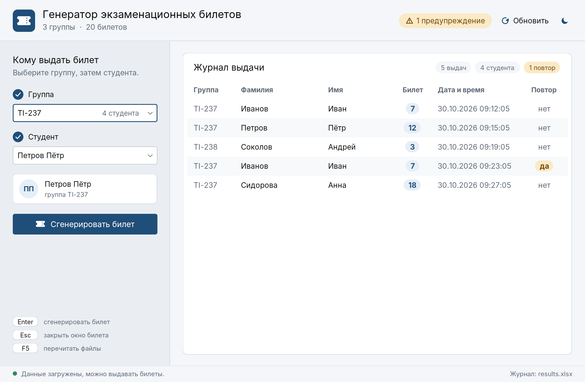
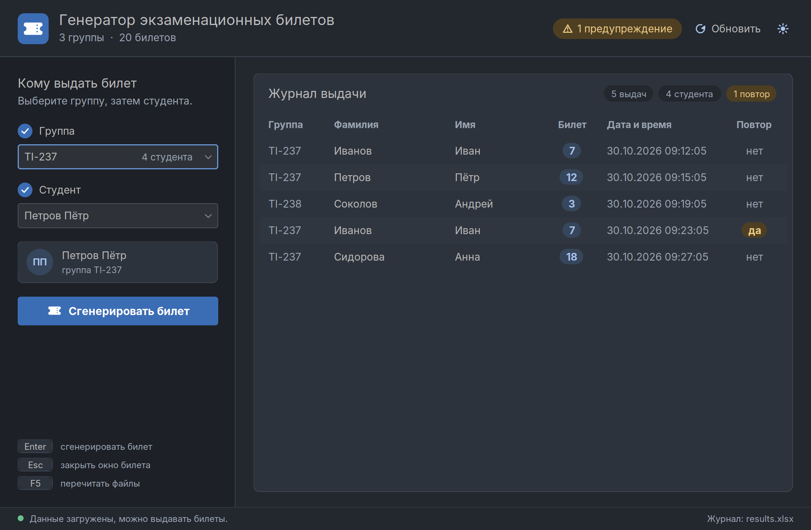
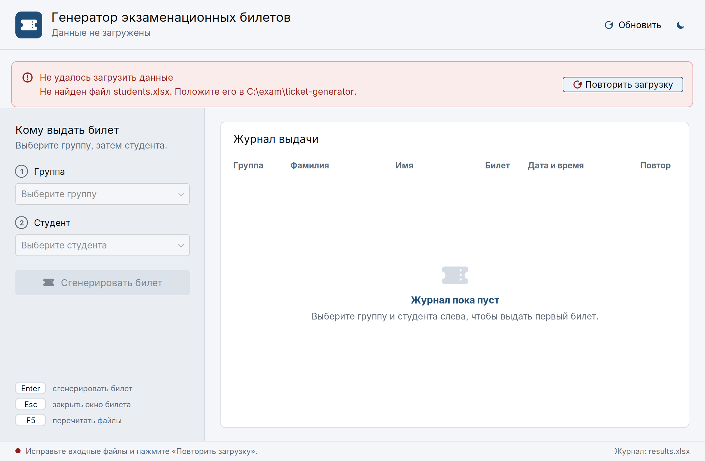
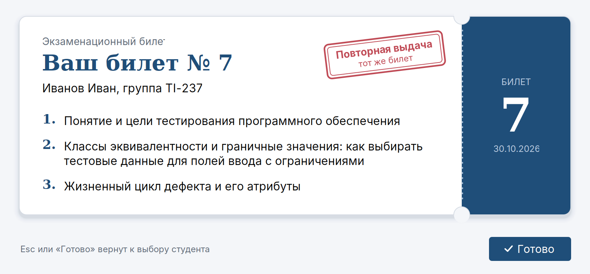

<div align="center">

# Генератор экзаменационных билетов

**Лабораторные работы №1 и №2** · Технический университет Молдовы, группа TI-237

Выдаёт студенту случайный экзаменационный билет, а при повторном обращении — тот же самый.
Каждую выдачу сразу записывает в журнал Excel.




</div>

---

## Содержание

1. [Два режима](#два-режима)
2. [Быстрый старт](#быстрый-старт)
3. [Интерфейс](#интерфейс)
4. [Как выполнены требования](#как-выполнены-требования)
5. [Юнит-тесты](#юнит-тесты)
6. [Принципы SOLID](#принципы-solid)
7. [Структура проекта](#структура-проекта)
8. [Ручная проверка](#ручная-проверка)

---

## Два режима

| Режим | Запуск | Что делает | Журнал |
|---|---|---|---|
| **Окно** (Лаб 2) | `java -jar target/ticket-generator.jar` | выбор группы и студента, билет в отдельном окне | `results.xlsx` |
| **Консоль** (Лаб 1) | `java -jar target/ticket-generator.jar --console` | ввод фамилии и имени, **Esc** — выход | `journal.xlsx` |

Общая основа обоих журналов — класс `XlsxLog`. Он пишет шапку, дописывает строки только в конец и
сохраняет файл после каждой записи через временный файл.

## Быстрый старт

Нужны **JDK 17+** и **Maven** (или IntelliJ IDEA, в ней Maven уже встроен).

```bash
mvn test                                   # все юнит-тесты
mvn package                                # тесты + сборка target/ticket-generator.jar
java -jar target/ticket-generator.jar      # запуск окна, из корня проекта
```

- Входные файлы `students.xlsx` и `tickets.docx` берутся из текущей папки. В корне проекта лежат образцы.
- `results.xlsx` и `tickets.log` создаются при первом запуске.
- Изменили входные файлы — нажмите **F5**, перезапуск не нужен.

## Интерфейс

<table>
<tr>
<td width="50%"></td>
<td width="50%"></td>
</tr>
<tr>
<td align="center"><sub>Тёмная тема</sub></td>
<td align="center"><sub>Нет входного файла: понятное сообщение и «Повторить загрузку»</sub></td>
</tr>
</table>

<p align="center"><br>
<sub>Билет при повторной выдаче: тот же номер и штамп «Повторная выдача»</sub></p>

**Шапка**
- Фирменный значок, название, число групп и билетов.
- Справа янтарная плашка с числом предупреждений (по клику — список), «Обновить» и переключатель темы ☾ / ☀.
- Выбранная тема запоминается между запусками.

**Слева: кому выдать билет**
- Два шага, «Группа» и «Студент». Номер шага превращается в галочку, когда шаг выполнен.
- В списке групп сразу видно число студентов, у пустой группы — «нет студентов».
- Карточка выбранного студента с инициалами показывает, кому уйдёт билет.
- Кнопка «Сгенерировать билет» активна только когда выбраны группа и студент.

**Справа: журнал выдачи**
- Карточка с таблицей в полоску.
- Номер билета — синий бейдж, повтор — янтарный бейдж «да».
- Сверху сводка: выдачи, студенты, повторы.
- Новая запись сразу выделяется. Пока журнал пуст, вместо таблицы подсказка.

**Окно билета**
- Сделано как бумажный билет: отрывной корешок с крупным номером, перфорация, мягкая тень.
- При повторной выдаче на билете стоит штамп.

**Строка состояния**
- Цветная точка: зелёная — всё в порядке, янтарная — внимание, красная — ошибка.
- Справа имя файла журнала.

**Клавиши:** Enter — сгенерировать билет, Esc — закрыть окно билета, F5 — перечитать файлы.

Все иконки нарисованы кодом (`Icons`), а не взяты из картинок: они чёткие при любом масштабе экрана и
перекрашиваются вместе с темой.

## Как выполнены требования

| Ситуация | Поведение |
|---|---|
| Нет `students.xlsx` или `tickets.docx` | Красная панель с текстом, где ждут файл, и кнопкой «Повторить загрузку». Приложение не падает |
| Пустая группа | Список студентов пуст и недоступен, подсказка «В этой группе нет студентов», кнопка неактивна |
| `results.xlsx` открыт в Excel | Диалог «Повторить / Отмена». Отмена — билет не выдан, в журнал ничего не пишется |
| Некорректный билет (меньше 3 вопросов, не распознан заголовок) | Билет пропускается, причина пишется в `tickets.log` и показывается по кнопке предупреждений |
| Выбор номера билета | Случайно, только среди корректных билетов: пропущенный билет не выпадет |
| Повторный выбор студента | Берётся номер из первой записи студента, дописывается строка с «да» в колонке «Повтор». Студент определяется по группе, фамилии и имени, без учёта регистра и лишних пробелов |
| Нумерация вопросов в Word | Распознаётся и ручная «1. текст», и автоматический список Word |
| Esc в окне билета | Закрывает окно билета, приложение остаётся открытым |

## Юнит-тесты

```bash
mvn test
```

**125 тестов в 22 тестовых классах** (JUnit 5). Тесты не трогают настоящие файлы пользователя, не
открывают окна (режим `java.awt.headless`) и не зависят от времени, часового пояса и случайности.

| Слой | Тестовый класс | Тестов | Что проверяется |
|---|---|:-:|---|
| **Консоль (Лаб 1)** | `ConsoleAppTest` | 7 | Несколько студентов подряд, номер билета от 1 до 20, Esc, повтор при занятом файле, время без долей секунды |
| | `JournalTest` | 1 | Колонки и формат даты в `journal.xlsx` |
| **Файлы** | `TicketsParserTest` | 11 | Варианты заголовка «Билет 7», «Билет №7:», автонумерация Word, меньше 3 вопросов, нераспознанный заголовок, повтор номера, неразрывные пробелы |
| | `DocxTicketsSourceTest` | 4 | Настоящий `.docx`, нумерованный список Word, повреждённый и отсутствующий файл |
| | `XlsxStudentsSourceTest` | 7 | Лист = группа, строка заголовка, пустая группа, строка без имени, повреждённый и отсутствующий файл |
| | `XlsxLogTest` | 7 | Шапка, дозапись в конец, дата как настоящая дата Excel, повреждённый файл не перезаписывается |
| | `ResultsJournalTest` | 6 | Колонки `results.xlsx`, «да» для повтора, старые строки не меняются, строки без студента пропускаются |
| | `AtomicFileTest` | 4 | Сохранение через временный файл: старый файл цел при ошибке |
| | `ParsedTicketsTest` | 1 | Результат чтения нельзя изменить снаружи |
| **Контракт хранилища** | `ResultsJournalContractTest` | 5 | Один и тот же набор проверок для Excel-журнала… |
| | `InMemoryResultsStoreContractTest` | 5 | …и для журнала в памяти (подстановка Лисков) |
| **Логика** | `TicketServiceTest` | 12 | Случайный билет, тот же билет при повторе и после перезапуска, регистр и пробелы в ФИО, однофамилец из другой группы, журнал недоступен |
| | `TicketsControllerTest` | 9 | Загрузка, повтор/отмена при занятом файле, ошибки входных данных |
| | `SourceLoaderTest` | 4 | Сообщения об ошибках вместо исключений |
| | `SourceLoaderFilesTest` | 3 | То же на настоящих файлах |
| **Интерфейс** | `SelectionPanelTest` | 10 | Кнопка активна только при выборе группы и студента, пустая группа, сброс |
| | `HistoryTableModelTest` | 5 | Колонки журнала, «да» для повтора, пустая дата |
| | `StudentCardTest` | 3 | Инициалы, карточка скрыта без студента |
| | `JournalStatsTest` | 3 | Подсчёт выдач, студентов и повторов |
| | `StatusBarTest` | 1 | Текст и оттенок строки состояния |
| | `HtmlTest` | 2 | Текст вопроса не может вставить разметку |
| | `RussianTest` | 15 | «1 группа», «3 группы», «11 групп» |

**Приёмы, которые делают тесты надёжными**
- **Подделки вместо настоящих зависимостей:** журнал в памяти `InMemoryResultsStore` умеет имитировать
  «файл открыт в Excel», а `ScriptedPrompt` заменяет клавиатуру в консольном режиме.
- **Фиксированные часы и случайность:** `Clock.fixed(...)` и `new Random(seed)`, поэтому результат
  всегда один и тот же.
- **Контрактный тест:** абстрактный `ResultsStoreContractTest` выполняется для каждой реализации журнала.
- **Временные папки:** `@TempDir` — каждый тест работает со своими файлами.

**Что исправлено при проверке (24.11.2026)**
- `ConsoleAppTest.entryHasCurrentTimeWithoutFraction` зависел от часового пояса компьютера. Часы теста
  были в UTC, а ожидаемое время считалось в поясе системы. В Кишинёве (UTC+2) тест падал, на сервере
  в UTC проходил. Теперь ожидаемое время задано явно.
- Добавлено 12 тестов на новые части интерфейса и на `ParsedTickets`.

## Принципы SOLID

Проект проверен по каждому принципу. Ниже — где принцип выполняется, как это видно в коде и что
было исправлено при проверке.

| Принцип | Как выполняется | Чем подтверждено |
|---|---|---|
| **S** — единственная ответственность | Разбор `.docx` (`TicketsParser`), чтение `.xlsx` (`XlsxStudentsSource`), правила выдачи (`TicketService`), сценарии с повтором (`TicketsController`) и окно — разные классы. `XlsxLog` делегирует значения ячеек `ExcelCells`, а безопасное сохранение — `AtomicFile`. В интерфейсе каждая панель — свой класс: `SelectionPanel`, `JournalPanel`, `ErrorBanner`, `StatusBar`, `StudentCard`, `TicketView` | Каждый класс тестируется отдельно, без остальных |
| **O** — открытость/закрытость | Новый формат входных данных (CSV, база) — новая реализация `StudentsSource` / `TicketsSource`. Новое хранилище журнала — новая реализация `ResultsStore`. Существующий код не меняется. Поведение при занятом файле передаётся снаружи (`Predicate<IOException> retry`) | Журнал в памяти подключается к сервису без единой правки в `TicketService` |
| **L** — подстановка Лисков | Любая реализация `ResultsStore` взаимозаменяема | `ResultsStoreContractTest` — одни и те же 5 проверок для Excel-журнала и журнала в памяти |
| **I** — разделение интерфейсов | Интерфейсы узкие: `ResultsStore` (2 метода), `StudentsSource`, `TicketsSource` (по 2), `CatalogSource` (1), `Prompt` (3), `EntryLog` (1) | Ни одна реализация не содержит методов-заглушек |
| **D** — инверсия зависимостей | Сервис и контроллер получают зависимости через конструктор: `ResultsStore`, `CatalogSource`, `Random`, `Clock`. Окно получает готовый контроллер. Все конкретные классы и пути к файлам собираются в одном месте — `Main` | В тестах те же классы получают подделки |

**Что исправлено при проверке (24.11.2026)**

1. **D — интерфейс зависел от реализации.** `TicketsSource.read()` возвращал `TicketsParser.Result`,
   вложенный тип конкретного парсера. Из-за этого и `SourceLoader` (слой логики) импортировал класс
   разбора Word. Результат вынесен в отдельный тип `ParsedTickets`, и теперь абстракция не знает о
   способе разбора.
2. **D — пути к файлам были в двух местах.** Консольный режим сам решал, что журнал называется
   `journal.xlsx`. Теперь путь задаёт `Main`, как и для остальных файлов:
   `ConsoleApp.run(CONSOLE_JOURNAL_FILE)`.
3. **S — разросшееся окно.** При обновлении интерфейса строка состояния, карточка студента и иконки
   вынесены в отдельные классы `StatusBar`, `StudentCard`, `Icons`, а не добавлены в `MainView`.

**Осознанные компромиссы**
- `TicketsController` сам создаёт `TicketService` после загрузки билетов. Сервису нужен список билетов,
  который появляется только во время работы. Фабрика ради одного класса усложнила бы код без пользы.
  Контроллер при этом полностью тестируется через подделки `CatalogSource` и `ResultsStore`.
- `Theme` и `AppLog` — статические утилиты. Тема и лог в приложении одни, и подменять их в тестах не нужно.

## Структура проекта

```
src/main/java/tickets/
├── Main                 точка входа; единственное место, где собираются зависимости и пути к файлам
├── AppLog               лог в консоль и tickets.log
├── model/               Student, Ticket, ResultRecord, Assignment
├── io/                  работа с файлами
│   ├── StudentsSource, TicketsSource, ResultsStore      интерфейсы
│   ├── XlsxStudentsSource, DocxTicketsSource            реализации для Excel и Word
│   ├── TicketsParser, ParsedTickets                     разбор текста билетов
│   ├── ResultsJournal                                   results.xlsx
│   └── XlsxLog, ExcelCells, ExcelFiles, AtomicFile      дозапись, ячейки, безопасное сохранение
├── service/             логика без интерфейса
│   ├── TicketService                                    правила выдачи
│   ├── TicketsController                                сценарии: загрузка, выдача, повтор
│   └── CatalogSource, SourceLoader, LoadResult, Catalog
├── ui/                  окно (Лаб 2)
│   ├── Theme, Icons                                     тема FlatLaf и векторные иконки
│   ├── MainFrame, MainView, StatusBar                   окно, шапка, строка состояния
│   ├── SelectionPanel, StudentCard                      выбор группы и студента
│   ├── JournalPanel, HistoryTableModel, JournalStats    журнал выдачи
│   ├── ErrorBanner, Dialogs                             ошибки и диалоги
│   └── TicketView, ResultDialog                         окно билета
└── console/             консоль (Лаб 1): ConsoleApp, Prompt, ConsoleInput, EntryLog, Journal
```

## Ручная проверка

1. Выбрать группу — в списке студенты этого листа, у группы видно число студентов. Пока не выбраны оба, кнопка серая.
2. Сгенерировать билет — окно с номером и вопросами. В `results.xlsx` сразу появилась строка, в журнале окна она выделена.
3. Выбрать того же студента снова — тот же номер, штамп «Повторная выдача», новая строка внизу, «Повтор» = да.
4. Нажать Esc в окне билета — окно закрылось, приложение работает.
5. Открыть `results.xlsx` в Excel и сгенерировать билет — диалог «Повторить». Закрыть Excel, нажать «Повторить» — строка записана.
6. Переименовать `tickets.docx` и нажать F5 — красная панель с ошибкой. Вернуть имя и снова F5 — всё работает.
7. Выбрать группу TI-239 — пустой список, подсказка, кнопка неактивна.
8. Переключить тему кнопкой ☾ / ☀ и перезапустить — тема сохранилась.
